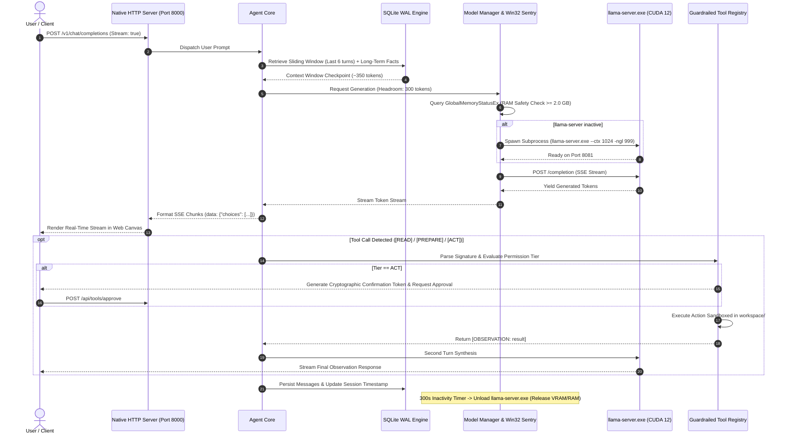

# MEERA — Autonomous Edge AI Agent & Local-First Intelligence Platform

```
================================================================================
MEERA: PRODUCTION-GRADE ON-DEVICE AI AGENT & EDGE INFERENCE RUNTIME
Local-First // Zero Third-Party Web Dependencies // Pure Python Standard Library
Deployment Baseline: Windows 10/11 & Server // NVIDIA CUDA 12+ // Cross-Platform Fallback
Architecture: On-Device LLM Reasoning // Deterministic Token Budgeting // SQLite WAL
================================================================================
```

**Meera** is an autonomous, local-first artificial intelligence agent and edge inference runtime engineered for high-performance reasoning, deterministic memory management, guardrailed tool execution, and multi-agent task orchestration in resource-constrained enterprise and edge environments.

Engineered under a strict **zero third-party web dependency** architectural principle, Meera eliminates external runtime bloat (no Flask, FastAPI, Uvicorn, or Node.js). Its complete networking layer, process lifecycle supervisor, persistent database engine, and operating system bindings are implemented entirely utilizing the Python standard library. Meera provides strict data sovereignty, ensuring zero data exfiltration for compliance-critical deployments (HIPAA, GDPR, FERPA) while maintaining drop-in compatibility with the official OpenAI API specification.

---

## ◈ System Architecture & End-to-End Request Pipeline

```
+---------------------------------------------------------------------------------------------------+
|                                          CLIENT INTERFACES                                        |
|  [Obsidian Dark Web Console]     [OpenAI SDK / Python]     [Open WebUI / Cursor]    [Terminal CLI]|
+-------------------------------------------------+-------------------------------------------------+
                                                  | HTTP / SSE Stream
                                                  v
+---------------------------------------------------------------------------------------------------+
|                                 NATIVE SYSTEM NETWORKING LAYER                                    |
|                       http.server // socketserver.ThreadingMixIn (Port 8000)                      |
|   - OpenAI Spec (/v1/chat/completions, /v1/models)     - Meera REST API (/api/*)                  |
|   - Token-by-Token SSE Chunk Streamer                  - Static Asset Deployer & CORS Middleware  |
+-------------------------------------------------+-------------------------------------------------+
                                                  |
                                                  v
+---------------------------------------------------------------------------------------------------+
|                                  AGENT CORE & REASONING ENGINE                                    |
|   - Multi-Turn Sliding Window History                  - Deterministic Token Allocator (1024 Max) |
|   - Zero-Overhead Skills Intent Router                 - Context Summarization Checkpoints        |
+-------------------+-----------------------------+-----------------------------+-------------------+
                    |                             |                             |
                    v                             v                             v
+-----------------------------+  +----------------------------+  +----------------------------------+
|    MODEL INFERENCE ENGINE   |  |   GUARDRAILED EXECUTION    |  |     PERSISTENT WAL STORAGE       |
|  - Subprocess Supervisor    |  |  - [READ] Workspace FS     |  |  - SQLite WAL (memory.db)        |
|  - Win32 Kernel RAM Sentry  |  |  - [PREPARE] Python REPL   |  |  - Sessions & Transcripts        |
|    (GlobalMemoryStatusEx)   |  |  - [ACT] Shell Commands    |  |  - Long-Term User Facts          |
|  - 300s Idle Auto-Reaper    |  |    (Human Approval Token)  |  |  - Project Workspaces & Notes    |
|  - llama-server.exe CUDA 12 |  |  - Native JSON-RPC MCP     |  |  - Coursework Deadlines & Tasks  |
|    (Quantized GGUF Models)  |  |    Client Adapter (stdio)  |  |  - Channel Announcements Sentry  |
+-----------------------------+  +----------------------------+  +----------------------------------+
                                                  ^
                                                  |
+-------------------------------------------------+-------------------------------------------------+
|                                SPECIALIZED CAPABILITY SUBSYSTEMS                                  |
|  - TaskScheduler: Micro-threaded background daemon worker & recurring cron scheduler              |
|  - AcademicSurfer: Zero-dependency iCalendar (RFC 5545) & university feed synchronizer            |
|  - TeamsConnector: Microsoft OAuth2 Device Code grant (RFC 8628) & channel announcements sentry  |
|  - KnowledgeVault: Persistent local document archive with base64 streaming & context injection    |
|  - MultiAgentOrchestrator: Isolated sub-agent context windows & executive report synthesis        |
+---------------------------------------------------------------------------------------------------+
```

### Flow Sequence Diagram



---

## ⬡ Target Hardware Deployment Profiles & Resource Governance

Meera is optimized for edge nodes, developer workstations, and enterprise on-premises micro-servers:

| Deployment Profile | Hardware Baseline | Resource Enforcement Policy |
| :--- | :--- | :--- |
| **Edge Gateway / Embedded** | 4 Cores, 8 GB System RAM, Integrated / Entry GPU | Sub-millisecond Win32 RAM sentry blocks inference if system RAM < 2.0 GiB; KV-cache locked to 1024 tokens. |
| **Developer Workstation** | 6-8 Cores, 8-16 GB System RAM, Dedicated GPU (4 GB - 8 GB VRAM) | Inference capped at 4 CPU threads (preserving host OS and DWM responsiveness); weights + KV-cache allocated ~2.5 GB dedicated VRAM budget. |
| **Production Edge Server** | 8+ Cores, 16+ GB System RAM, NVIDIA CUDA 12+ / Tensor Cores | High-throughput local SSE streaming; automated 300-second idle auto-unloader returning VRAM and system memory back to the host operating system. |

### Memory & Process Guardrails
1. **Native Win32 Kernel RAM Sentry**: Direct operating system memory interrogation via `ctypes.windll.kernel32.GlobalMemoryStatusEx` for zero-overhead, sub-millisecond RAM safety checks before model activation.
2. **5-Minute Idle Auto-Reclamation**: If no generation requests are received for 300 seconds, `ModelManager` cleanly terminates the `llama-server.exe` process group, releasing ~1.5 GB to 2.5 GB of VRAM back to the host GPU driver.
3. **Deterministic Token Budgeting (1024 Context Ceiling)**: To guarantee low latency and zero Out-Of-Memory (OOM) faults on entry-level edge accelerators, context is deterministically budgeted:
   - **System Persona**: ~120 tokens
   - **Long-Term Memory Store**: ~100 tokens (up to 5 verified user facts/preferences)
   - **Session Summary Checkpoint**: ~150 tokens (extractive or model-generated checkpoint)
   - **Sliding Message Window**: ~350 tokens (last 6 conversation turns preserved verbatim)
   - **Generation Headroom**: ~300 tokens reserved for model completion
   - **Token Estimation Heuristic**: Standard library approximation: `max(len(text)/3.5, len(text.split())*1.3) + 1` (eliminates heavy external tokenizers).
4. **CPU Thread Allocation & Core Affinity**: Inference threads are hard-capped at 4 threads, leaving hyperthreads free for system operations and smooth user interface rendering.

---

## ⬡ Core Competencies & ATS Keyword Taxonomy

Meera demonstrates full-stack systems engineering, distributed edge computing, and applied artificial intelligence competencies:

| Domain | Industry Keywords & ATS Competencies | Production Implementation in Meera |
| :--- | :--- | :--- |
| **Artificial Intelligence & LLMs** | Large Language Models (LLMs), Autonomous AI Agents, Edge AI, On-Device AI, Quantization (GGUF, 4-bit, Q4_K_M, INT8), llama.cpp Runtime, CUDA 12 Hardware Acceleration, Model Context Protocol (MCP), Context Window Engineering, Token Budgeting, Sliding Window Attention, Extractive Summarization, Multi-Agent Orchestration, Sub-Agent Context Isolation, Agentic Workflows. | Built a complete local agent runtime running quantized models under a deterministic 1024 token budget with sub-agent isolation and multi-step orchestration. |
| **Low-Latency Systems & OS Internals** | Win32 API Interoperability, `ctypes`, Process Lifecycle Management, Subprocess Supervisors, Kernel Memory Sentries, Out-Of-Memory (OOM) Mitigation, Process Groups, Job Objects, Resource Reclamation, CPU Thread Throttling, Daemon Threads. | Direct Windows kernel monitoring via `GlobalMemoryStatusEx`; subprocess group lifecycle management; automated 300-second idle VRAM/RAM reclamation. |
| **Backend & Network Systems** | RESTful API Engineering, OpenAI API Specification Drop-in Compatibility, Server-Sent Events (SSE), HTTP/1.1 Chunked Transfer Encoding, Socket Programming, Multi-Threading, Thread Pools, Event-Driven Architecture, Micro-Daemons, Cron Job Schedulers. | Zero third-party web dependencies. Built natively with Python's standard library `http.server`, `socketserver.ThreadingMixIn`, and low-level streaming socket wrappers. |
| **Security, Auth & Governance** | Least-Privilege Architecture, Human-in-the-Loop (HITL), Guardrailed Execution, Sandbox Isolation, Path Traversal Defense, OAuth 2.0 Device Authorization Grant (RFC 8628), Token Lifecycle Management, Silent Token Refresh, Zero Cloud Exfiltration (Local Data Sovereignty). | Three-tier security permissions (`READ`, `PREPARE`, `ACT`); cryptographic confirmation tokens; workspace boundary jail; silent OAuth token renewal. |
| **Database & Persistence** | Relational Database Design, SQLite WAL (Write-Ahead Logging), ACID Compliance, Thread-Safe Concurrency, `RLock` Synchronization, Foreign Key Cascading Deletions, Context Memory Checkpointing, 90-Day Retention Policies, Tombstone Records. | Multi-session SQLite architecture (`storage/memory.db`) with WAL journal mode, atomic transactions, automatic titling, and 90-day academic task pruning. |
| **Frontend & UI/UX Engineering** | Vanilla HTML5 / CSS3 / ES6+, Zero-Framework Architecture, Obsidian Dark Design System, Frosted Glassmorphism, Micro-Animations, Fixed-Anchor Non-Shifting Responsive Layout, CSS Grid & Flexbox, Real-Time Dynamic DOM Synchronization. | Custom-designed web console featuring a centered typing dock, non-shifting responsive layout, month calendar matrix, and real-time alerts. |

---

## ◈ Key Architectural Subsystems

### 1. Zero-Dependency Networking & OpenAI Compatibility
Meera provides complete drop-in compatibility with the official OpenAI API specification without external web frameworks:
- **Endpoints**: `/v1/chat/completions`, `/v1/models`, `/health`.
- **Streaming**: Native Server-Sent Events (SSE) streaming with HTTP chunked encoding.
- **Client Integration**: Seamlessly connects to Cursor, Continue, Open WebUI, or the standard `openai` Python SDK.

### 2. Guardrailed Three-Tier Tool Execution & Model Context Protocol (MCP)
Meera implements a secure, layered tool execution system:
- **`READ` Tier (Autonomous)**: Read-only filesystem operations strictly confined within the sandboxed `workspace/` folder (`list_directory`, `read_file`, `search_files`).
- **`PREPARE` Tier (Sandboxed)**: Python computational scratchpad (`evaluate_python`) executing arithmetic and data transforms with restricted built-in primitives.
- **`ACT` Tier (Human-in-the-Loop)**: High-impact shell execution (`run_command`) requiring affirmative human confirmation token approval before invocation.
- **Native MCP Adapter**: Pure standard-library JSON-RPC 2.0 client communicating over standard input/output (`stdio`) pipes with external MCP tool servers.

### 3. Persistent SQLite Write-Ahead Logging (WAL) Memory Engine
- **Engine**: Local SQLite database configured with `PRAGMA journal_mode=WAL;` and `threading.RLock()` synchronization.
- **Relational Integrity**: Foreign key cascading deletions (`ON DELETE CASCADE`) ensure sessions, messages, and summaries are cleaned atomically.
- **Long-Term Memory Store**: Persistent key-value facts and user preferences dynamically injected into the system prompt.
- **Context Summarization Checkpoints**: Extractive summarization preserves continuity across extended multi-turn sessions without token overflow.

### 4. Zero-Overhead Skills Engine & Multi-Agent Orchestration
- **Zero Token Footprint When Dormant**: Dormant skills consume 0 tokens from the system context window. Only when activated explicitly or auto-detected does the agent inject ~60-80 tokens of focused behavioral guidelines.
- **MultiAgentOrchestrator**: Coordinates sequential or parallel `SubAgent` workers, each executing within an isolated 1024-token context window to prevent prompt pollution, synthesizing results into an executive briefing.

### 5. Microsoft Teams OAuth2 Device Code Connector & Channel Sentry
- **RFC 8628 Flow**: Implemented entirely via standard library `urllib.request` with zero third-party Azure SDKs, utilizing the official Microsoft public client ID.
- **Silent Token Renewal**: Background worker silently refreshes access tokens before expiration, maintaining continuous synchronization without user re-authentication.
- **Course Channel Sentry**: Periodically monitors enrolled class teams for announcements, exams, and schedule changes, routing notices into the Alerts console with deduplication.

### 6. Academic Calendar & Coursework Synchronization Engine
- **iCalendar (RFC 5545) Engine**: Native parsing of `.ics` and `webcal` feeds with authenticated cookie support.
- **Interactive Month Calendar Grid**: Visual day-matrix with platform-coded event chips, priority indicators, and completion toggles.
- **Automated 90-Day Retention Policy**: Prunes academic records older than 90 days and purges legacy academic years to keep the calendar matrix relevant and fast.

### 7. Knowledge Library Vault & Document Context Injection
- **Local Document Storage**: Persistent document repository (`storage/library/`) for course syllabi, lab manuals, and research PDFs.
- **Base64 Document Ingestion**: Standard library file upload, validation, and MIME detection.
- **Ask Meera Integration**: One-click prompt context injection allows instant semantic reasoning and summarization over uploaded materials.

### 8. Project Workspaces & Sandboxed File Management
- **Context Partitioning**: Organizes chats, notes, and tasks into dedicated project containers with customizable color accents.
- **Sandboxed Workspace**: File creation and listing confined strictly within project subfolders inside `workspace/`.

### 9. Plugins Ecosystem & Connector Hub
- **Modular Plugin Interface**: Manages connections for LMS, Microsoft Teams, GitHub, and external MCP servers.
- **Live Connectivity Testing**: Interactive health checks and feed verification directly from the UI Plugins modal.

---

## ⬡ Repository Structure

```
Meera/
├── agent/
│   ├── __init__.py
│   └── core.py               # Context builder, sliding window, and tool dispatch orchestrator
├── api/
│   ├── __init__.py
│   └── server.py             # ThreadedTCPServer, OpenAI endpoint, SSE streamer, asset deployer
├── config/
│   ├── __init__.py
│   └── settings.py           # Hardware configurations, model paths, RAM thresholds, port mappings
├── docs/
│   ├── Meera_Project_Continuation_Document.docx
│   └── Meera_Project_Continuation_Document.pdf
├── memory/
│   ├── __init__.py
│   ├── context.py            # Token budget estimator, auto-titler, and context summarizer
│   ├── models.py             # Dataclasses (Session, Message, Project, AcademicDeadline, LibraryItem)
│   └── sqlite.py             # WAL SQLite engine, thread-safe session & memory CRUD operations
├── model/
│   ├── __init__.py
│   ├── llama_cpp.py          # llama-server subprocess manager & streaming SSE client
│   ├── manager.py            # On-demand loader, Windows Win32 memory sentry, 300s idle reaper
│   └── provider.py           # Abstract Base Classes (ModelProvider, ChatMessage, StreamChunk)
├── permissions/
│   ├── __init__.py
│   ├── manager.py            # PermissionManager & confirmation token lifecycle
│   └── policy.py             # SecurityPolicy, workspace boundary guard & blocked command filters
├── storage/
│   ├── library/              # Local persistent document vault (PDFs, lab manuals)
│   └── memory.db             # Local SQLite database (WAL mode, gitignored)
├── workspace/                # Isolated agent user workspace (sandbox for tasks/files)
├── tools/
│   ├── __init__.py
│   ├── base.py               # BaseTool ABC & ToolResult contract
│   ├── computational.py      # PREPARE tier: PythonEvalTool computational scratchpad
│   ├── filesystem.py         # READ tier: ListDirectoryTool, ReadFileTool, SearchFilesTool
│   ├── mcp.py                # Native JSON-RPC Model Context Protocol client adapter
│   ├── registry.py           # ToolRegistry, compact schema builder & execution dispatcher
│   └── system.py             # ACT tier: RunCommandTool shell executor
├── skills/
│   ├── __init__.py
│   ├── manifest.py           # SkillManifest contract & prompt extension schema
│   ├── coding.py             # Code synthesis & software architecture manifest
│   ├── academic.py           # Academic & research assistant manifest
│   ├── career.py             # Career strategist & interview coaching manifest
│   ├── registry.py           # SkillRegistry, zero-overhead intent routing
│   ├── scheduler.py          # Background task worker daemon & recurring cron scheduler
│   ├── academic_surfer.py    # Zero-dependency LMS & calendar feed synchronizer
│   ├── teams_connector.py    # Microsoft OAuth2 Device Code connector & channel alert sentry
│   └── orchestrator.py       # MultiAgentOrchestrator & SubAgent context isolation
├── ui/
│   ├── assets/               # Deployed background artwork & assets
│   ├── app.js                # Session manager, SQLite API sync, SSE consumer, keyboard shortcuts
│   ├── index.html            # Top floating island, shrinkable sidebar command center, chat canvas
│   └── style.css             # Obsidian dark theme, typography tokens, fixed centered console dock
├── tests/
│   ├── __init__.py
│   ├── test_model.py         # ModelManager, ModelProvider contracts & RAM sentry tests
│   ├── test_phase1.py        # Core contracts & initial sanity test suite
│   ├── test_phase2.py        # UI & OpenAI endpoint tests
│   ├── test_phase3.py        # SQLite persistent memory & context budget tests
│   ├── test_phase4.py        # Guardrailed tools, permissions & MCP tests
│   └── test_phase5.py        # Skills engine, cron task worker & multi-agent orchestrator tests
├── main.py                   # Main CLI & Server entry point
├── AGENTS.md                 # System specifications & project tracking
└── README.md                 # Engineering architecture & comprehensive documentation
```

---

## ▲ Quick Start Guide

### 1. Prerequisites
- **Python**: Version 3.10, 3.11, or 3.12 (Standard Library).
- **llama.cpp**: Release binary from [llama.cpp Releases](https://github.com/ggerganov/llama.cpp/releases) (e.g. `llama-bXXXX-bin-win-cuda-cu12.x-x64.zip`).
- **GGUF Model**: Quantized model placed inside `models/` (e.g., `Qwen3-1.7B-Q4_K_M.gguf`).

### 2. Setup
```powershell
# Clone the repository
git clone https://github.com/Arshit-dv/Meera.git
cd Meera

# Extract llama-server.exe into runtime directory
# Target path: runtime/llama.cpp/llama-server.exe
```

### 3. Launching Meera

#### Mode A: Web Console & API Server
```powershell
python main.py --server
```
- **Web Interface**: Open `http://127.0.0.1:8000` in any modern browser.
- **OpenAI Compatible Endpoint**: `http://127.0.0.1:8000/v1/chat/completions`
- **Health Telemetry**: `http://127.0.0.1:8000/health`

#### Mode B: Interactive Terminal CLI
```powershell
python main.py
```
- Fast interactive CLI streaming tokens directly to stdout.
- Special commands: `/status` (system RAM & model state), `/reset` (clear session), `exit` (clean shutdown).

---

## ◈ REST API Reference

### System & OpenAI Specification
| Endpoint | Method | Description |
| :--- | :--- | :--- |
| `/` | `GET` | Serves the built-in Vanilla HTML/CSS/JS Obsidian Web Console |
| `/v1/chat/completions` | `POST` | OpenAI-compatible chat completion (streaming SSE & JSON response) |
| `/v1/models` | `GET` | Lists active and configured local GGUF models |
| `/health` | `GET` | Real-time telemetry (RAM headroom, model loaded state, session count) |

### Chat Sessions & Memory
| Endpoint | Method | Description |
| :--- | :--- | :--- |
| `/api/sessions` | `GET` | Retrieves all persistent conversation sessions |
| `/api/sessions` | `POST` | Creates a new chat session |
| `/api/sessions/<id>` | `GET` | Retrieves full session transcript and latest summary |
| `/api/sessions/<id>` | `PATCH` | Updates session title or metadata |
| `/api/sessions/<id>` | `DELETE` | Permanently deletes session with cascading cleanup |
| `/api/sessions/<id>/title`| `POST` | Updates session title directly |
| `/api/sessions/active` | `POST` | Switches active server session pointer |
| `/api/reset` | `POST` | Resets conversation context window |
| `/api/memories` | `GET` | Lists long-term memory facts (optional category filter) |
| `/api/memories` | `POST` | Stores or updates verified user preference/fact |

### Projects & Workspace Files
| Endpoint | Method | Description |
| :--- | :--- | :--- |
| `/api/projects` | `GET` | Lists all project workspaces |
| `/api/projects` | `POST` | Creates a new project workspace |
| `/api/projects/<id>` | `GET` | Retrieves specific project details |
| `/api/projects/<id>` | `PATCH` | Updates project name, color, or description |
| `/api/projects/<id>` | `DELETE` | Deletes a project workspace |
| `/api/files` | `GET` | Lists files sandboxed in `workspace/` (supports `project_id`) |
| `/api/files` | `POST` | Creates or saves file in sandboxed workspace directory |

### Guardrailed Tools & Skills
| Endpoint | Method | Description |
| :--- | :--- | :--- |
| `/api/tools` | `GET` | Lists registered tools with compact signatures and permission tiers |
| `/api/tools/execute` | `POST` | Executes tool directly (with confirmation token if ACT tier) |
| `/api/tools/approve` | `POST` | Approves pending ACT confirmation token |
| `/api/tools/deny` | `POST` | Rejects pending ACT confirmation token |
| `/api/tools/pending` | `GET` | Lists actions awaiting human-in-the-loop confirmation |
| `/api/skills` | `GET` | Lists available skill manifests and active domain |
| `/api/skills/activate` | `POST` | Manually activates a specialized domain skill |
| `/api/orchestrator/delegate` | `POST` | Spawns isolated Sub-Agent worker for multi-step tasks |
| `/api/tasks` | `GET` | Lists active and scheduled background tasks |
| `/api/tasks` | `POST` | Schedules recurring cron or one-shot delay task |
| `/api/tasks/<id>` | `DELETE` | Cancels an active background task |

### Academic Schedules & Microsoft Teams
| Endpoint | Method | Description |
| :--- | :--- | :--- |
| `/api/schedules/deadlines` | `GET` | Lists coursework deadlines (filters: platform, completed, date) |
| `/api/schedules/deadlines` | `POST` | Adds a manual academic task or deadline |
| `/api/schedules/deadlines/<id>` | `PATCH` | Updates deadline completion status or details |
| `/api/schedules/deadlines/<id>` | `DELETE` | Removes deadline and records deletion tombstone |
| `/api/schedules/sync` | `POST` | Triggers background academic LMS and Teams sync |
| `/api/schedules/config` | `GET` / `POST` | Reads or updates academic calendar URLs and cookies |
| `/api/teams/status` | `GET` | Checks Microsoft Teams OAuth connection and unread alert count |
| `/api/teams/joined` | `GET` | Lists enrolled class teams |
| `/api/teams/devicecode/start` | `POST` | Starts Microsoft RFC 8628 Device Code authorization flow |
| `/api/teams/devicecode/poll` | `POST` | Polls Microsoft token endpoint for authorization approval |
| `/api/teams/sync` | `POST` | Manually synchronizes Teams assignments and channel alerts |
| `/api/teams/alerts` | `GET` | Lists course channel announcement alerts |
| `/api/teams/alerts/read` | `POST` | Marks specific alert or all alerts as read |
| `/api/teams/alerts/refresh` | `POST` | Scans enrolled channels for new announcements |
| `/api/teams/alerts/delete` | `POST` | Deletes specific alert or all alerts from database |
| `/api/teams/alerts/<id>` | `DELETE` | Deletes specific alert notice |

### Plugins & Knowledge Library Vault
| Endpoint | Method | Description |
| :--- | :--- | :--- |
| `/api/plugins` | `GET` | Lists registered connectors (LMS, Teams, GitHub, MCP) |
| `/api/plugins/<id>` | `GET` | Retrieves configuration state for a specific plugin |
| `/api/plugins/config` | `POST` | Updates plugin configuration, credentials, or enabled state |
| `/api/plugins/test` | `POST` | Tests live connectivity for a configured plugin |
| `/api/library` | `GET` | Lists documents stored in the persistent Knowledge Vault |
| `/api/library/upload` | `POST` | Uploads document (PDF, notes) via pure standard-library base64 |
| `/api/library/file/<id>` | `GET` | Streams or downloads document binary directly |
| `/api/library/<id>` | `DELETE` | Permanently deletes document and database record |

---

## ⬡ Integration with External Clients

### Python OpenAI SDK
```python
from openai import OpenAI

client = OpenAI(
    base_url="http://127.0.0.1:8000/v1",
    api_key="meera-local",
)

response = client.chat.completions.create(
    model="meera",
    messages=[
        {"role": "user", "content": "Explain zero-dependency systems engineering concisely."}
    ],
    stream=True,
)

for chunk in response:
    delta = chunk.choices[0].delta.content
    if delta:
        print(delta, end="", flush=True)
```

### Cursor / Continue / Open WebUI
- **Base URL**: `http://127.0.0.1:8000/v1`
- **API Key**: `meera` (or any string)
- **Model**: `meera` or `qwen3-1.7b`

---

## ▤ Test Suite

Run the full standard library test suite to verify provider contracts, memory engines, security permissions, and REST routes:

```powershell
python -m unittest discover tests
```

---

## ◈ Design Guidelines & Project Policies

1. **Zero Emojis**: Strictly enforced across UI, terminal logs, code comments, and documentation. Uses classic typographic glyphs (`◈`, `⬡`, `▤`, `◷`, `▲`, `[UI]`, `[API]`, `[STATUS]`) to preserve a professional, luxury aesthetic.
2. **Zero Third-Party Web Frameworks**: Built natively on `http.server` and `socketserver.ThreadingMixIn`.
3. **Rock-Solid Centered UI Layout**: Fixed center-anchored console dock with zero horizontal jitter on sidebar toggle (`Ctrl+B`).
4. **Strict Workspace Isolation**: All filesystem tools and commands are jailed inside the `workspace/` sandbox directory.

---

## ◈ License

MIT License. Engineered by [Arshit](https://github.com/Arshit-dv) for local-first, privacy-preserving edge AI computing.
