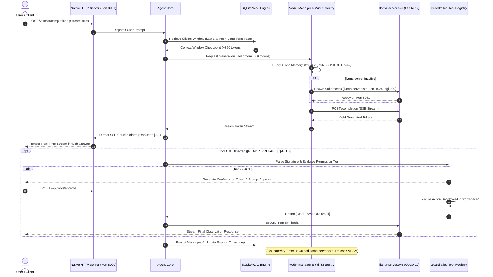

# MEERA — Autonomous Personal AI Agent & Local Edge Architecture

```
================================================================================
MEERA (PERSONAL AI AGENT ARCHITECTURE)
Local-First // Zero Third-Party Web Dependencies // Pure Python Standard Library
Target: Windows 11 (64-bit) // NVIDIA CUDA 12 // Intel Core i5 // RTX 2050
Specifications: 1024 Token Budget // SQLite WAL Engine // Native Win32 Sentry
================================================================================
```

**Meera** is an autonomous, local-first personal AI agent engineered from scratch to deliver high-performance LLM reasoning, multi-session persistent memory, guardrailed tool execution, and multi-agent task orchestration on consumer-grade hardware. 

Built under a strict **zero third-party web dependency** rule, Meera requires no external web frameworks (no Flask, FastAPI, Uvicorn, or Node.js). Its complete networking layer, process supervisor, database persistence, and operating system bindings are implemented entirely with the Python standard library.

---

## ◈ System Architecture & End-to-End Request Pipeline

```
+---------------------------------------------------------------------------------------------------+
|                                          CLIENT INTERFACES                                        |
|  [Obsidian Dark Web Console]     [OpenAI SDK / Python]     [Open WebUI / Cursor]    [Terminal CLI]|
+-------------------------------------------------+-------------------------------------------------+
                                                  | HTTP / SSE Stream
                                                  v
+---------------------------------------------------------------------------------------------------+
|                                 NATIVE SYSTEM NETWORKING LAYER                                    |
|                       http.server // socketserver.ThreadingMixIn (Port 8000)                      |
|   - OpenAI Spec (/v1/chat/completions, /v1/models)     - Meera REST API (/api/*)                  |
|   - Token-by-Token SSE Chunk Streamer                  - Static Asset Deployer                    |
+-------------------------------------------------+-------------------------------------------------+
                                                  |
                                                  v
+---------------------------------------------------------------------------------------------------+
|                                  AGENT CORE & REASONING ENGINE                                    |
|   - Multi-Turn Sliding Window History                  - Token Budget Allocator (1024 Ceiling)    |
|   - Zero-Overhead Skills Intent Router                 - Context Summarization Checkpoints        |
+-------------------+-----------------------------+-----------------------------+-------------------+
                    |                             |                             |
                    v                             v                             v
+-----------------------------+  +----------------------------+  +----------------------------------+
|    MODEL INFERENCE ENGINE   |  |   GUARDRAILED EXECUTION    |  |     PERSISTENT WAL STORAGE       |
|  - Subprocess Supervisor    |  |  - [READ] Workspace FS     |  |  - SQLite WAL (memory.db)        |
|  - Win32 RAM Sentry         |  |  - [PREPARE] Python REPL   |  |  - Sessions & Transcripts        |
|    (GlobalMemoryStatusEx)   |  |  - [ACT] Shell Commands    |  |  - Long-Term User Facts          |
|  - 300s Idle Auto-Reaper    |  |    (Human Approval Token)  |  |  - Academic Deadlines & Tasks    |
|  - llama-server.exe CUDA 12 |  |  - Native JSON-RPC MCP     |  |  - Channel Announcements Sentry  |
|    (Qwen 1.7B / 4-bit GGUF) |  |    Client Adapter (stdio)  |  |  - Foreign Key Cascade Cleanup   |
+-----------------------------+  +----------------------------+  +----------------------------------+
                                                  ^
                                                  |
+-------------------------------------------------+-------------------------------------------------+
|                                SPECIALIZED CAPABILITY SUBSYSTEMS                                  |
|  - TaskScheduler: Micro-threaded background daemon worker & recurring cron scheduler              |
|  - AcademicSurfer: Zero-dependency iCalendar (.ics) and university feed synchronization           |
|  - TeamsConnector: Microsoft OAuth2 Device Code grant (RFC 8628) & channel announcements sentry  |
|  - MultiAgentOrchestrator: Isolated sub-agent context windows & executive report synthesis        |
+---------------------------------------------------------------------------------------------------+
```

### Flow Sequence Diagram



---

## ⬡ Core Competencies & ATS Keyword Taxonomy

For technical recruiters and engineering hiring managers, Meera demonstrates competencies across systems engineering, distributed architecture, and artificial intelligence:

| Domain | Industry Keywords & ATS Competencies | Implementation in Meera |
| :--- | :--- | :--- |
| **Artificial Intelligence & LLMs** | Large Language Models (LLMs), AI Agents, Edge AI, On-Device AI, Quantization (GGUF, 4-bit, Q4_K_M), Model Context Protocol (MCP), Context Window Engineering, Token Budgeting, Sliding Window Attention, Extractive Summarization, Multi-Agent Orchestration. | Designed a complete local agent runtime running quantized models under a strict 1024 context ceiling on an NVIDIA RTX 2050 (4 GB GDDR6). |
| **Systems & OS Internals** | Win32 API Interoperability, `ctypes`, Process Lifecycle Management, Subprocess Supervisors, Memory Sentry, Out-Of-Memory (OOM) Prevention, Process Groups, Job Objects, Resource Reclamation, CPU Thread Allocation. | Direct Windows kernel monitoring via `GlobalMemoryStatusEx`; subprocess group cleanup; automatic 300-second idle VRAM/RAM reclamation. |
| **Backend & Network Systems** | RESTful API Engineering, OpenAI API Specification, Server-Sent Events (SSE), Socket Programming, Multi-Threading, Thread Pools, Event-Driven Architecture, Micro-Daemons, Cron Job Schedulers. | Zero third-party web dependencies. Built natively with Python's `http.server`, `socketserver.ThreadingMixIn`, and low-level streaming socket wrappers. |
| **Security & Authorization** | Least Privilege Security, Human-in-the-Loop (HITL), Guardrailed Execution, Sandbox Isolation, Path Traversal Defense, OAuth 2.0 Device Authorization Grant (RFC 8628), Token Lifecycle Management. | Three-tier security permissions (`READ`, `PREPARE`, `ACT`); cryptographic confirmation tokens; workspace boundary jail; silent OAuth token renewal. |
| **Database & Persistence** | Relational Database Design, SQLite WAL (Write-Ahead Logging), Thread-Safe Concurrency, `RLock` Synchronization, Foreign Key Integrity, Cascading Deletions, Context Memory Checkpointing. | Multi-session SQLite architecture (`storage/memory.db`) with WAL journal mode, atomic transactions, automatic titling, and 90-day academic task pruning. |
| **Frontend & UI Engineering** | Vanilla HTML5 / CSS3 / ES6+, Zero-Framework Architecture, Obsidian Dark Design System, CSS Grid & Flexbox, Backdrop Blur, Accessible Typography, Dynamic State Synchronization. | Custom-designed web console featuring a centered typing console, non-shifting responsive layout, month calendar matrix, and real-time alerts. |

---

## ▤ Hardware Specifications & Runtime Guardrails

All architectural choices are tailored for optimal execution on resource-constrained host hardware:

| Metric | Target Specification | Operational Enforcement |
| :--- | :--- | :--- |
| **Host Machine** | ASUS TUF Gaming F17 | Windows 11 (64-bit) |
| **Processor** | Intel Core i5-11400H @ 2.70GHz (6C / 12T) | Inference hard-capped at 4 threads (leaving 8 hyperthreads free for DWM and desktop responsiveness). |
| **System Memory** | ~7.73 GiB Usable RAM | Native Win32 sentry blocks model execution if free RAM < 2.0 GiB. |
| **Dedicated GPU** | NVIDIA GeForce RTX 2050 (4 GB GDDR6) | Model weights + KV cache constrained to ~2.5 GB dedicated VRAM budget. |
| **CUDA Driver** | CUDA 12.4 | `llama-server.exe` compiled with CUDA 12 architecture optimizations. |
| **Default Model** | `Qwen3-1.7B-Q4_K_M.gguf` | Quantized 4-bit weights (~1.2 GB disk footprint, fast token generation). |

---

## ◈ Key Architectural Subsystems

### 1. Zero-Dependency Networking & OpenAI Compatibility
Meera provides full drop-in compatibility with the official OpenAI API specification without pulling in heavyweight dependencies like FastAPI or Uvicorn:
- **Endpoints**: `/v1/chat/completions`, `/v1/models`, `/health`.
- **Streaming**: Native Server-Sent Events (SSE) streaming with HTTP chunked encoding.
- **Client Integration**: Seamlessly connects to Cursor, Continue, Open WebUI, or the standard `openai` Python SDK.

### 2. Guardrailed Three-Tier Tool Execution & Model Context Protocol (MCP)
Meera implements a secure, layered tool execution system:
- **`READ` Tier (Autonomous)**: Read-only filesystem operations strictly confined within the sandboxed `workspace/` folder (`list_directory`, `read_file`, `search_files`).
- **`PREPARE` Tier (Sandboxed)**: Python computational scratchpad (`evaluate_python`) executing arithmetic and data transforms with restricted built-in primitives.
- **`ACT` Tier (Human-in-the-Loop)**: Shell command execution (`run_command`) requiring affirmative human confirmation token approval before invocation.
- **Native MCP Adapter**: Pure standard-library JSON-RPC 2.0 client communicating over standard input/output (`stdio`) pipes with external MCP tool servers.

### 3. Persistent SQLite Memory Engine & Token Budget Sentry
Context is deterministically partitioned to operate within the 1024 context budget:
- **System Persona**: ~120 tokens.
- **Long-Term Memory Store**: Up to 5 verified user preferences and facts injected into context.
- **Session Summary Checkpoint**: Extractive summarization preserves context beyond turn limits.
- **Sliding Message Window**: Last 6 conversation turns preserved verbatim.
- **Generation Headroom**: ~300 tokens reserved for model completion.
- **Engine**: SQLite configured with `PRAGMA journal_mode=WAL;` and `threading.RLock()` synchronization.

### 4. Zero-Overhead Skills Engine & Multi-Agent Orchestration
- **Dormant State**: Zero token footprint when dormant. Behavioral extensions (~60-80 tokens) are injected dynamically only upon explicit activation or heuristic keyword intent match.
- **MultiAgentOrchestrator**: Deploys isolated `SubAgent` workers with dedicated context windows to execute multi-step research, architecture design, and code synthesis plans.

### 5. Microsoft Teams OAuth2 Device Code Connector & Channel Sentry
- **RFC 8628 Device Authorization**: Pure standard-library implementation of the Microsoft Device Code flow via `urllib.request`. Zero Azure SDK dependencies.
- **Channel Sentry**: Scans enrolled class channels for professor announcements, exams, and schedule changes, routing notices into the Alerts console.
- **Academic Retention Policy**: Strict 90-day cutoff sentry and automated past-year pruning ensure calendar views only display relevant current-semester coursework.

### 6. Project Workspaces & Sandboxed File Management
- **Project Context Partitioning**: Chats, notes, and tasks can be grouped within customizable project workspaces with unique accent colors.
- **Sandboxed File Operations**: Pure Python file management confined to the project directory within `workspace/`.

### 7. Knowledge Library Vault & Document Context Injection
- **Local Document Storage**: Persistent document repository (`storage/library/`) for course syllabi, lab manuals, and research PDFs.
- **Ask Meera Integration**: One-click prompt context injection allows instant semantic reasoning and summarization over uploaded materials.

### 8. Plugins Ecosystem & Connector Hub
- **Zero-Dependency Connectors**: Modular plugin interface for LMS, Microsoft Teams, GitHub, and external MCP servers.
- **Real-Time Connectivity Testing**: Interactive health and connection verification directly from the UI Plugins modal.

---

## ⬡ Repository Structure

```
Meera/
├── agent/
│   ├── __init__.py
│   └── core.py               # Context builder, sliding window, and tool dispatch orchestrator
├── api/
│   ├── __init__.py
│   └── server.py             # ThreadedTCPServer, OpenAI endpoint, SSE streamer, asset deployer
├── config/
│   ├── __init__.py
│   └── settings.py           # Hardware configurations, model paths, RAM thresholds, port mappings
├── docs/
│   ├── Meera_Project_Continuation_Document.docx
│   └── Meera_Project_Continuation_Document.pdf
├── memory/
│   ├── __init__.py
│   ├── context.py            # Token budget estimator, auto-titler, and context summarizer
│   ├── models.py             # Dataclasses (Session, Message, Project, AcademicDeadline, LibraryItem)
│   └── sqlite.py             # WAL SQLite engine, thread-safe session & memory CRUD operations
├── model/
│   ├── __init__.py
│   ├── llama_cpp.py          # llama-server subprocess manager & streaming SSE client
│   ├── manager.py            # On-demand loader, Windows Win32 memory sentry, 300s idle reaper
│   └── provider.py           # Abstract Base Classes (ModelProvider, ChatMessage, StreamChunk)
├── permissions/
│   ├── __init__.py
│   ├── manager.py            # PermissionManager & confirmation token lifecycle
│   └── policy.py             # SecurityPolicy, workspace boundary guard & blocked command filters
├── storage/
│   ├── library/              # Local persistent document vault (PDFs, lab manuals)
│   └── memory.db             # Local SQLite database (WAL mode, gitignored)
├── workspace/                # Isolated agent user workspace (sandbox for tasks/files)
├── tools/
│   ├── __init__.py
│   ├── base.py               # BaseTool ABC & ToolResult contract
│   ├── computational.py      # PREPARE tier: PythonEvalTool computational scratchpad
│   ├── filesystem.py         # READ tier: ListDirectoryTool, ReadFileTool, SearchFilesTool
│   ├── mcp.py                # Native JSON-RPC Model Context Protocol client adapter
│   ├── registry.py           # ToolRegistry, compact schema builder & execution dispatcher
│   └── system.py             # ACT tier: RunCommandTool shell executor
├── skills/
│   ├── __init__.py
│   ├── manifest.py           # SkillManifest contract & prompt extension schema
│   ├── coding.py             # Code synthesis & software architecture manifest
│   ├── academic.py           # Academic & research assistant manifest
│   ├── career.py             # Career strategist & interview coaching manifest
│   ├── registry.py           # SkillRegistry, zero-overhead intent routing
│   ├── scheduler.py          # Background task worker daemon & recurring cron scheduler
│   ├── academic_surfer.py    # Zero-dependency LMS & calendar feed synchronizer
│   ├── teams_connector.py    # Microsoft OAuth2 Device Code connector & channel alert sentry
│   └── orchestrator.py       # MultiAgentOrchestrator & SubAgent context isolation
├── ui/
│   ├── assets/               # Deployed background artwork & assets
│   ├── app.js                # Session manager, SQLite API sync, SSE consumer, keyboard shortcuts
│   ├── index.html            # Top floating island, shrinkable sidebar command center, chat canvas
│   └── style.css             # Obsidian dark theme, typography tokens, fixed centered console dock
├── tests/
│   ├── __init__.py
│   ├── test_model.py         # ModelManager, ModelProvider contracts & RAM sentry tests
│   ├── test_phase1.py        # Core contracts & initial sanity test suite
│   ├── test_phase2.py        # UI & OpenAI endpoint tests
│   ├── test_phase3.py        # SQLite persistent memory & context budget tests
│   ├── test_phase4.py        # Guardrailed tools, permissions & MCP tests
│   └── test_phase5.py        # Skills engine, cron task worker & multi-agent orchestrator tests
├── main.py                   # Main CLI & Server entry point
├── AGENTS.md                 # System specifications & project tracking
└── README.md                 # Engineering architecture & comprehensive documentation
```

---

## ▲ Quick Start Guide

### 1. Prerequisites
- **Python**: Version 3.10, 3.11, or 3.12 (Standard Library).
- **llama.cpp**: Release binary from [llama.cpp Releases](https://github.com/ggerganov/llama.cpp/releases) (e.g. `llama-bXXXX-bin-win-cuda-cu12.x-x64.zip`).
- **GGUF Model**: Quantized model placed inside `models/` (e.g., `Qwen3-1.7B-Q4_K_M.gguf`).

### 2. Setup
```powershell
# Clone the repository
git clone https://github.com/Arshit-dv/Meera.git
cd Meera

# Extract llama-server.exe into runtime directory
# Target path: runtime/llama.cpp/llama-server.exe
```

### 3. Launching Meera

#### Mode A: Web Console & API Server
```powershell
python main.py --server
```
- **Web Interface**: Open `http://127.0.0.1:8000` in any modern browser.
- **OpenAI Compatible Endpoint**: `http://127.0.0.1:8000/v1/chat/completions`
- **Health Telemetry**: `http://127.0.0.1:8000/health`

#### Mode B: Interactive Terminal CLI
```powershell
python main.py
```
- Fast interactive CLI streaming tokens directly to stdout.
- Special commands: `/status` (system RAM & model state), `/reset` (clear session), `exit` (clean shutdown).

---

## ◈ REST API Reference

### System & OpenAI Specification
| Endpoint | Method | Description |
| :--- | :--- | :--- |
| `/` | `GET` | Serves the built-in Vanilla HTML/CSS/JS Obsidian Web Console |
| `/v1/chat/completions` | `POST` | OpenAI-compatible chat completion (streaming SSE & JSON response) |
| `/v1/models` | `GET` | Lists active and configured local GGUF models |
| `/health` | `GET` | Real-time telemetry (RAM headroom, model loaded state, session count) |

### Chat Sessions & Memory
| Endpoint | Method | Description |
| :--- | :--- | :--- |
| `/api/sessions` | `GET` | Retrieves all persistent conversation sessions |
| `/api/sessions` | `POST` | Creates a new chat session |
| `/api/sessions/<id>` | `GET` | Retrieves full session transcript and latest summary |
| `/api/sessions/<id>` | `PATCH` | Updates session title or metadata |
| `/api/sessions/<id>` | `DELETE` | Permanently deletes session with cascading cleanup |
| `/api/sessions/<id>/title`| `POST` | Updates session title directly |
| `/api/sessions/active` | `POST` | Switches active server session pointer |
| `/api/reset` | `POST` | Resets conversation context window |
| `/api/memories` | `GET` | Lists long-term memory facts (optional category filter) |
| `/api/memories` | `POST` | Stores or updates verified user preference/fact |

### Projects & Workspace Files
| Endpoint | Method | Description |
| :--- | :--- | :--- |
| `/api/projects` | `GET` | Lists all project workspaces |
| `/api/projects` | `POST` | Creates a new project workspace |
| `/api/projects/<id>` | `GET` | Retrieves specific project details |
| `/api/projects/<id>` | `PATCH` | Updates project name, color, or description |
| `/api/projects/<id>` | `DELETE` | Deletes a project workspace |
| `/api/files` | `GET` | Lists files sandboxed in `workspace/` (supports `project_id`) |
| `/api/files` | `POST` | Creates or saves file in sandboxed workspace directory |

### Guardrailed Tools & Skills
| Endpoint | Method | Description |
| :--- | :--- | :--- |
| `/api/tools` | `GET` | Lists registered tools with compact signatures and permission tiers |
| `/api/tools/execute` | `POST` | Executes tool directly (with confirmation token if ACT tier) |
| `/api/tools/approve` | `POST` | Approves pending ACT confirmation token |
| `/api/tools/deny` | `POST` | Rejects pending ACT confirmation token |
| `/api/tools/pending` | `GET` | Lists actions awaiting human-in-the-loop confirmation |
| `/api/skills` | `GET` | Lists available skill manifests and active domain |
| `/api/skills/activate` | `POST` | Manually activates a specialized domain skill |
| `/api/orchestrator/delegate` | `POST` | Spawns isolated Sub-Agent worker for multi-step tasks |
| `/api/tasks` | `GET` | Lists active and scheduled background tasks |
| `/api/tasks` | `POST` | Schedules recurring cron or one-shot delay task |
| `/api/tasks/<id>` | `DELETE` | Cancels an active background task |

### Academic Schedules & Microsoft Teams
| Endpoint | Method | Description |
| :--- | :--- | :--- |
| `/api/schedules/deadlines` | `GET` | Lists coursework deadlines (filters: platform, completed, date) |
| `/api/schedules/deadlines` | `POST` | Adds a manual academic task or deadline |
| `/api/schedules/deadlines/<id>` | `PATCH` | Updates deadline completion status or details |
| `/api/schedules/deadlines/<id>` | `DELETE` | Removes deadline and records deletion tombstone |
| `/api/schedules/sync` | `POST` | Triggers background academic LMS and Teams sync |
| `/api/schedules/config` | `GET` / `POST` | Reads or updates academic calendar URLs and cookies |
| `/api/teams/status` | `GET` | Checks Microsoft Teams OAuth connection and unread alert count |
| `/api/teams/joined` | `GET` | Lists enrolled class teams |
| `/api/teams/devicecode/start` | `POST` | Starts Microsoft RFC 8628 Device Code authorization flow |
| `/api/teams/devicecode/poll` | `POST` | Polls Microsoft token endpoint for authorization approval |
| `/api/teams/sync` | `POST` | Manually synchronizes Teams assignments and channel alerts |
| `/api/teams/alerts` | `GET` | Lists course channel announcement alerts |
| `/api/teams/alerts/read` | `POST` | Marks specific alert or all alerts as read |
| `/api/teams/alerts/refresh` | `POST` | Scans enrolled channels for new announcements |
| `/api/teams/alerts/delete` | `POST` | Deletes specific alert or all alerts from database |
| `/api/teams/alerts/<id>` | `DELETE` | Deletes specific alert notice |

### Plugins & Knowledge Library Vault
| Endpoint | Method | Description |
| :--- | :--- | :--- |
| `/api/plugins` | `GET` | Lists registered connectors (LMS, Teams, GitHub, MCP) |
| `/api/plugins/<id>` | `GET` | Retrieves configuration state for a specific plugin |
| `/api/plugins/config` | `POST` | Updates plugin configuration, credentials, or enabled state |
| `/api/plugins/test` | `POST` | Tests live connectivity for a configured plugin |
| `/api/library` | `GET` | Lists documents stored in the persistent Knowledge Vault |
| `/api/library/upload` | `POST` | Uploads document (PDF, notes) via pure standard-library base64 |
| `/api/library/file/<id>` | `GET` | Streams or downloads document binary directly |
| `/api/library/<id>` | `DELETE` | Permanently deletes document and database record |

---

## ⬡ Integration with External Clients

### Python OpenAI SDK
```python
from openai import OpenAI

client = OpenAI(
    base_url="http://127.0.0.1:8000/v1",
    api_key="meera-local",
)

response = client.chat.completions.create(
    model="meera",
    messages=[
        {"role": "user", "content": "Explain zero-dependency systems engineering concisely."}
    ],
    stream=True,
)

for chunk in response:
    delta = chunk.choices[0].delta.content
    if delta:
        print(delta, end="", flush=True)
```

### Cursor / Continue / Open WebUI
- **Base URL**: `http://127.0.0.1:8000/v1`
- **API Key**: `meera` (or any string)
- **Model**: `meera` or `qwen3-1.7b`

---

## ▤ Test Suite

Run the full standard library test suite to verify provider contracts, memory engines, security permissions, and REST routes:

```powershell
python -m unittest discover tests
```

---

## ◈ Design Guidelines & Project Policies

1. **Zero Emojis**: Strictly enforced across UI, terminal logs, code comments, and documentation. Uses classic typographic glyphs (`◈`, `⬡`, `▤`, `◷`, `▲`, `[UI]`, `[API]`, `[STATUS]`) to preserve a professional, luxury aesthetic.
2. **Zero Third-Party Web Frameworks**: Built natively on `http.server` and `socketserver.ThreadingMixIn`.
3. **Rock-Solid Centered UI Layout**: Fixed center-anchored console dock with zero horizontal jitter on sidebar toggle (`Ctrl+B`).
4. **Strict Workspace Isolation**: All filesystem tools and commands are jailed inside the `workspace/` sandbox directory.

---

## ◈ License

MIT License. Engineered by [Arshit](https://github.com/Arshit-dv) for local-first, privacy-preserving personal AI computing.
